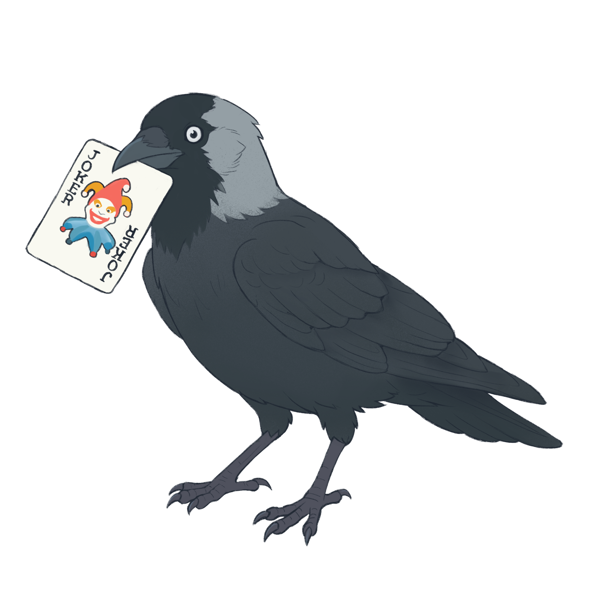

  
  <h1>Jackdaw</h1>

Bit-exact headless Balatro v1.0.1o simulator for reinforcement learning research.

---

## Pages

- [RL Project Guide](rl-guide) — Observations, actions, masks, rewards, the Gymnasium wrapper (works with MaskablePPO) and the vector env
- [Evaluating on Jackdaw Arena](arena) — The hosted benchmark: server-held seeds, a fixed budget per agent, verified and public results
- [Python API](api) — The Rust-backed `Game`: actions, legal moves, views, previews, snapshots, `GameBuilder`, speed
- [Lockstep against the live game](live) — `jackdaw lockstep`, divergence bundles, replay, the deviation catalog, and where the live game isn't vanilla
- [Validation & Scenarios](validation) — Validating the engine against live Balatro, writing your own test scenarios
- [BalatroBot on the simulator](balatrobot) — `jackdaw serve`, `SimBackend`, and how the simulator maps onto BalatroBot's API
- [Snapshot schema](snapshot-schema) — `jackdaw.snapshot/1`, the save and comparison format
- [Development](development) — The toolchain, the everyday commands, game data and fixtures
