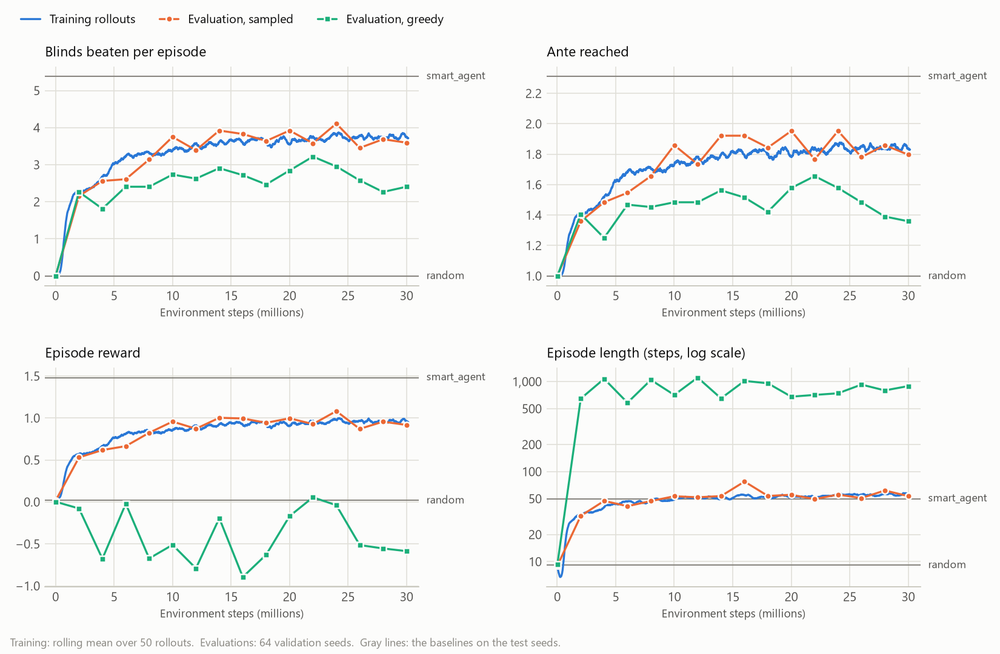

# Training demo: MaskablePPO on jackdaw

This folder trains [sb3-contrib](https://sb3-contrib.readthedocs.io/)'s MaskablePPO on the
simulator's `BalatroGymnasiumEnv` (Rust engine, flat `Discrete(500)` actions with masks), then
plays the trained policy against two baselines on the same runs: a random legal action at every
step, and `jackdaw.cli.smart_agent`, the repo's hand-written heuristic player.

## Results

The demo run trained for 30.2M environment steps in 65 min on 6 CPU threads, and was stopped
once learning had slowed to about 0.1 more blinds per 10M steps (see the curves). Every agent
then played the same 1,000 runs (seeds 10,000,000 to 10,000,999, Red Deck, stake 1), which
training and validation never saw:

| Agent | Mean ante reached | Blinds beaten per run | Win rate | Mean episode reward | Mean episode length (steps) |
|---|---:|---:|---:|---:|---:|
| MaskablePPO, sampled | 1.83 | 3.74 ± 0.11 | 0% | +0.96 | 57 |
| MaskablePPO, greedy | 1.48 | 2.65 ± 0.07 | 0% | -0.72 | 984 |
| `smart_agent` | 2.31 | 5.38 ± 0.13 | 0% | +1.48 | 50 |
| Random legal action | 1.00 | 0.001 ± 0.001 | 0% | +0.02 | 9 |

- **Sampled** draws each action from the policy's masked distribution, as in training. **Greedy**
  takes the most likely legal action.
- Blinds beaten: the mean and its standard error. The reward is the training reward (below),
  summed over the episode.
- Episodes end when the run is lost or won, or after 2,000 steps.

From beating essentially no blind, PPO learns to clear almost four per run and reaches ante 6 at
best. The hand-written `smart_agent` is still better: 1.6 more blinds per run, and ante 7 at
best. No agent wins a run.

The greedy policy is weaker than the sampled one because it loops. In some states its most
likely action is a free move (here mostly swapping two cards in the hand, or two jokers in the
shop), and from the next state another free move, and so on: 48% of its episodes run into the
2,000-step cap.
Sampling breaks such cycles (no sampled episode reached the cap), and the sampled policy is the
one PPO optimizes.

<picture>
  <source media="(prefers-color-scheme: dark)" srcset="results/learning_curve_dark.png">
  
</picture>

The four panels show the training rollouts (episodes that ended in each rollout, smoothed), and
evaluations every 2M steps on 64 fixed validation seeds, sampled and greedy. The gray lines are
the baselines on the test seeds. The same values are in
[`results/learning_curve.csv`](results/learning_curve.csv), one row per evaluation.

`results/` holds the summary (`eval_results.json`), the curves, the run's settings
(`config.json`) and the trained model (`maskable_ppo_balatro.zip`, without Adam's state, 2.5 MB).

## Install

The scripts need the `train` dependency group: stable-baselines3, sb3-contrib, tensorboard, torch
and matplotlib. It is a dependency group of this repository, not a dependency of the `jackdaw`
package, so neither `pip install jackdaw` nor a plain `uv sync` installs it:

```bash
uv sync --dev --group train
```

`uv sync` installs exactly the groups it is given, so a later plain `uv sync` (or
`uv sync --dev`) uninstalls the training packages again. Pass `--group train` every time, or use
`uv sync --all-groups`. torch comes from PyTorch's CPU wheel index, which `pyproject.toml` sets:
the demo trains a small MLP on the CPU, and the default Linux wheels would pull in several GB of
CUDA libraries.

## Train

```bash
uv run --group train python examples/train_maskable_ppo.py --timesteps 30154752
```

The defaults are the demo run's settings, except that it ran up to 60M steps and was stopped
after 3,681 updates of 8,192 steps; `--timesteps 30154752` ends at the same update. Training is
seeded (the envs' runs, the action-table sampler, torch, numpy), but floating-point results can
still differ with the hardware and the thread count. Everything goes to
`runs/maskable_ppo/<run>/`, which is gitignored:

| Path | What |
|---|---|
| `tb/` | TensorBoard logs: `uv run --group train tensorboard --logdir runs/maskable_ppo` |
| `checkpoints/` | the model every 5M steps |
| `best_model.zip` | the model with the most blinds beaten on the 64 validation seeds (sampled) |
| `final_model.zip` | the model at the end of training |
| `config.json` | the command-line settings |

Create a file named `STOP` in the run directory to end training early: the script still saves
`final_model.zip`. `--resume <model.zip>` continues from a saved model. `--help` lists the
hyperparameters.

Besides SB3's usual `rollout/` and `train/` scalars, the logs have:

- `balatro/ante_reached`, `balatro/blinds_beaten`, `balatro/win_rate`: means over the training
  episodes that ended in each rollout;
- `eval/` and `eval_sampled/`: every 2M steps, 64 episodes on fixed validation seeds, playing the
  most likely legal action (`eval/`) or sampling from the policy (`eval_sampled/`).

## Evaluate and plot

```bash
uv run --group train python examples/evaluate_agents.py \
    --model examples/results/maskable_ppo_balatro.zip --out examples/results/eval_results.json
uv run --group train python examples/plot_learning_curve.py runs/maskable_ppo/<run> \
    --baselines examples/results/eval_results.json --out examples/results/learning_curve
```

`evaluate_agents.py` plays one episode per test seed for each agent, with the reward and
episode cap from the `config.json` next to the model, prints the table above and writes the JSON
summary. The first command reproduces the table from the committed model in about two minutes.

## How the training is set up

**Environments.** 32 `BalatroGymnasiumEnv`s on the Rust engine (`DirectAdapter`) in SB3's
`DummyVecEnv`, wrapped in `VecMonitor` for episode statistics. Sub-env `i` starts from seed
`seed + i` and then plays runs `TRAIN<seed>_<i>_<n>`, so no two envs replay the same run.
`DummyVecEnv` resets an env within the step that ends its episode, puts the final observation in
`infos[i]["terminal_observation"]` (SB3 bootstraps truncated episodes from it) and returns the
new episode's first observation. MaskablePPO then reads the masks with
`env_method("action_masks")`, which asks each env for the mask of the observation it just
returned, so the policy always picks from the legal actions of the state it sees. A check over
17,415 automatic resets found every returned observation and mask equal to those of a fresh env
starting the same run.

**Why not `BalatroVectorEnv`.** The vector env steps several times faster than 32 Gym envs in a
`DummyVecEnv`, but it resets an ended episode on the *following* step (gymnasium's
`AutoresetMode.NEXT_STEP`): that step ignores the env's action and returns the new episode's
first observation with reward 0, and until then the env's mask is all False. An SB3 `VecEnv`
must return the new episode's first observation, and its mask, from the step that ended the last
one, and the vector env can reset a sub-env only by stepping all the others with it (or by
resetting them all). Wrapping it would put one fake transition per episode into PPO's rollout
buffer: an action chosen with every action masked, which the env ignores, scored as a real step
in the advantages, the value targets and the episode statistics. The env is not the bottleneck
anyway: on 6 threads MaskablePPO trains at up to about 10K steps/s (7.8K on average over the demo
run, on a machine shared with other work), half in rollouts and half in updates. Stepping the 32
envs takes about a fifth of the time (they run at about 46K steps/s on their own), so even an
instant env would save at most a fifth of the wall clock.

**Reward.** `ShapedReward(score_progress=0.1, blind_beaten=0.5, boss_beaten=0.3, loss=0)`: the
built-in dense reward (computed in Rust) with heavier progress terms and no loss penalty.
`step_cost` (0.001), `shop_step_cost` (0.002), `hands_left` (0.01) and `win` (0.5) keep their
defaults. With the default weights, putting off the end of a lost run saves
`loss * (1 - gamma)` per step, which equals `step_cost` at `gamma = 0.995`, so stalling is free.
In a pilot with the defaults, the greedy policy learned to alternate sorting and swapping cards
until the 2,000-step cap and beat no blind. Pilots with the same settings otherwise (on the
engine before G206, see below):

| Reward | Blinds beaten on the validation seeds (greedy / sampled) |
|---|---|
| `ShapedReward()`, after 0.3M steps | 0.00 / 0.00, greedy episodes of 1,627 steps |
| `ShapedReward(loss=0)`, after 1M steps | 1.30 / 1.02 |
| the demo's reward, after 1M steps | 2.56 / 1.55 |

**Hyperparameters.**

| | |
|---|---|
| Policy | `MultiInputPolicy`: the dict observation flattened (614 features), separate policy and value MLPs of 2 x 256 ReLU units |
| Rollouts | 32 envs x 256 steps = 8,192 transitions per update |
| Updates | 4 epochs, minibatches of 2,048, Adam at 3e-4 (constant) |
| PPO | gamma 0.995, GAE lambda 0.95, clip 0.2, entropy 0.01, value 0.5, max grad norm 0.5 |
| Episodes | Red Deck, stake 1, ended by a loss, a win or 2,000 steps |
| Threads | `--threads 6` caps torch's and the BLAS libraries' thread pools |

torch's OpenMP threads spin between calls, so training keeps its 6 cores busy throughout. With
`KMP_BLOCKTIME=0` in the environment they sleep instead: about 2.3 cores on average, but training
runs about a third slower.

**Refusals.** `BalatroGymnasiumEnv` raises `IllegalActionError` if the engine refuses an
action from its own table, where `BalatroVectorEnv` ends that episode instead. The
`EndOnRefusal` wrapper does the same here, so that an env bug can't stop a long run, and prints
the refusal. None happened in the demo run or its evaluations.

**Engine versions.** A trained policy is tied to the action masks it was trained with. G206 (a
fix to follow the game's drag and drop) made joker swaps legal at blind select and on the
cash-out screen. A first demo model, trained just before it, had never seen those table slots
unmasked there: on the engine with G206, 97% of its sampled moves were those swaps, and its
blinds beaten per run fell from 4.1 to 2.2. The model here was trained after the change. Retrain
(or fine-tune) a policy when the masks change.

## Files

| File | What |
|---|---|
| `train_maskable_ppo.py` | training |
| `evaluate_agents.py` | the evaluation against the baselines |
| `plot_learning_curve.py` | the learning curves from the TensorBoard logs |
| `balatro_sb3.py` | what the scripts share: envs, callbacks, the evaluation loop |
| `results/` | the demo run's summary, curves, settings and model |
